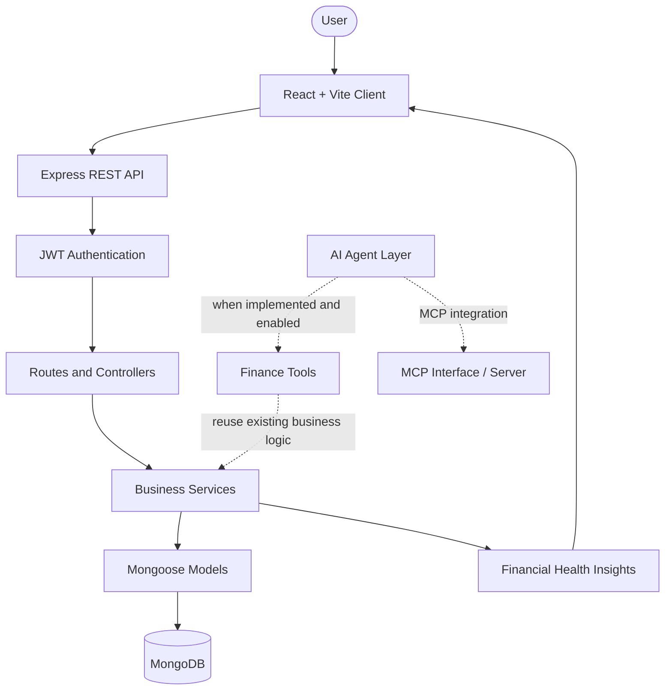

<div align="center">

# FinPilot

### Agentic AI-Powered Personal Finance Management System with MCP Integration

A full-stack personal finance platform for tracking expenses, managing budgets, and understanding financial activity through analytics — with an AI-agent architecture designed to extend financial workflows.

<br/>


<br/>

**Personal Finance · Analytics · AI Agent Architecture · MCP**

</div>

---

## 📌 Overview

**FinPilot** is a personal finance management application built with the MERN stack. It brings expense tracking, income management, budgets, and financial analytics into one interface.

The project also explores an **agentic AI extension** using **LangChain.js, LangGraph.js, and the Model Context Protocol (MCP)** to connect AI workflows with application capabilities. The core application is organized around reusable backend services, making it easier to extend functionality while preserving the existing business logic.

> **Project status:** Active development. The finance application and AI/MCP components may be at different stages of implementation. See the codebase for the current set of working features.

## ✨ Features

<table>
<tr>
<td width="50%" valign="top">

### 💸 Finance Management
- Expense CRUD and category organization
- Income record management
- Budget creation and updates
- Budget progress and status indicators
- Paginated transaction retrieval

</td>
<td width="50%" valign="top">

### 📊 Dashboard & Insights
- Financial summary dashboard
- Category-based spending visualization
- Monthly financial trends
- Recent transaction activity
- Financial health score and recommendations
- CSV export for financial records

</td>
</tr>
<tr>
<td width="50%" valign="top">

### 🔐 Authentication & Security
- User registration and login
- Password hashing
- JWT-protected routes
- Authenticated user context
- User-scoped financial data access

</td>
<td width="50%" valign="top">

### 🤖 AI & MCP Architecture
- LangChain.js for model and tool integration
- LangGraph.js for agent workflow orchestration
- MCP integration for standardized tool interoperability
- Reuse of existing finance services by AI tools
- User-scoped tool execution design

</td>
</tr>
</table>

*AI/MCP items describe the intended integration architecture; only treat individual workflows as available when their implementation is present and configured in the repository.*

## 🧰 Tech Stack

| Layer | Technologies |
|---|---|
| Frontend | React 18, Vite, React Router DOM |
| UI | Tailwind CSS, Lucide React |
| Data visualization | Recharts |
| API communication | Axios |
| Backend | Node.js, Express.js |
| Database | MongoDB, Mongoose |
| Authentication | JSON Web Tokens (JWT), bcryptjs |
| AI / Agent orchestration | LangChain.js, LangGraph.js |
| Tool interoperability | Model Context Protocol (MCP) |

## 🏗️ Architecture

The core application uses a layered backend architecture. The React client communicates with the Express API, which applies authentication and delegates application logic to services and MongoDB models.



### 🧠 AI and MCP Design

The AI extension is intended to work with the existing Node.js backend rather than duplicate financial business logic in a separate service.

- **LangChain.js** — connects language models with application tools.
- **LangGraph.js** — coordinates multi-step agent workflows.
- **MCP** — provides a standardized interface for exposing tools to compatible AI clients.
- **Service reuse** — AI tools should call existing finance services for supported operations.
- **Access control** — the server should derive the user identity from authenticated context and validate tool arguments before accessing financial data.

The precise flow and MCP transport should match the implementation in the repository.

## 🗂️ Project Structure

```text
finpilot-agentic-ai-mcp/
├── client/
│   └── src/
│       ├── api/
│       ├── components/
│       ├── context/
│       ├── pages/
│       └── App.jsx
├── server/
│   ├── src/
│   │   ├── config/
│   │   ├── controllers/
│   │   ├── middlewares/
│   │   ├── models/
│   │   ├── routes/
│   │   ├── services/
│   │   └── utils/
│   ├── server.js
│   └── package.json
├── docs/
└── README.md
```

<details>
<summary><strong>📁 What the main directories are for</strong></summary>

- `client/` — React frontend and user interface.
- `server/` — Express API and backend application.
- `config/` — environment and database configuration.
- `controllers/` — HTTP request handling.
- `middlewares/` — authentication and shared request processing.
- `models/` — Mongoose data models.
- `routes/` — API route definitions.
- `services/` — reusable business logic and financial operations.
- `docs/` — project documentation and engineering plans.

</details>

## 🚀 Getting Started

### Prerequisites

- [Node.js](https://nodejs.org/) 18 or later
- npm
- [MongoDB](https://www.mongodb.com/) running locally or a MongoDB connection URI

### 1. Clone the repository

```bash
git clone https://github.com/YOUR_USERNAME/finpilot-agentic-ai-mcp.git
cd finpilot-agentic-ai-mcp
```

Replace `YOUR_USERNAME` with your GitHub username.

### 2. Set up the backend

```bash
cd server
npm install
```

Create a `.env` file using the variable names expected by the server configuration or `.env.example`.

Example local configuration:

```env
PORT=5000
NODE_ENV=development
MONGODB_URI=mongodb://127.0.0.1:27017/financeflow
JWT_SECRET=replace_with_a_long_random_secret
```

> Use the exact environment variable names required by the code. Never commit `.env` files, API keys, or other secrets.

Start the backend using the script available in `server/package.json`, for example:

```bash
npm run dev
```

### 3. Set up the frontend

Open a second terminal from the repository root:

```bash
cd client
npm install
npm run dev
```

Open the local URL printed by Vite, commonly `http://localhost:5173`.

### 4. Check the backend

The health endpoint is:

```http
GET /api/v1/health
```

Make sure MongoDB is running and the backend starts successfully before testing the frontend.

## 🔌 API Overview

The backend uses versioned REST endpoints under `/api/v1`.

| Endpoint | Purpose |
|---|---|
| `/api/v1/health` | Health check |
| `/api/v1/auth/register` | User registration |
| `/api/v1/auth/login` | User login |
| `/api/v1/auth/me` | Current authenticated user |
| `/api/v1/categories` | Category operations |
| `/api/v1/expenses` | Expense operations |
| `/api/v1/incomes` | Income operations |
| `/api/v1/budgets` | Budget operations |
| `/api/v1/dashboard` | Dashboard and analytics |
| `/api/v1/insights` | Financial health insights |
| `/api/v1/recurring` | Recurring transaction operations |
| `/api/v1/export/csv` | CSV export |

> Verify each route against the backend route files before relying on this table as definitive API documentation.

## 🔒 Security Practices

- Hash passwords before storing them.
- Protect private endpoints with authentication middleware.
- Restrict financial records to the authenticated user.
- Keep secrets in environment variables.
- Validate request bodies and AI tool arguments.
- Apply authorization checks to AI-triggered operations as well as normal API requests.
- Reuse the application's business services instead of allowing AI tools to bypass access controls.

## 🛣️ Possible Next Steps

- Complete and validate AI-agent workflows.
- Finish MCP tool exposure and client/server integration.
- Add automated tests for tool authorization and financial operations.
- Expand financial insights and reporting.
- Add screenshots and a short product demo.

## 👨💻 Author

**Althaf Yazin**  
B.Tech Computer Science and Engineering  
MAR ATHANASIUS COLLEGE OF ENGINEERING, Kerala

## 📄 License

No license is specified by default. Add a `LICENSE` file if you intend to permit public reuse, modification, or distribution.

---

<div align="center">

**FinPilot** · Making personal finance easier to understand and manage.

</div>
