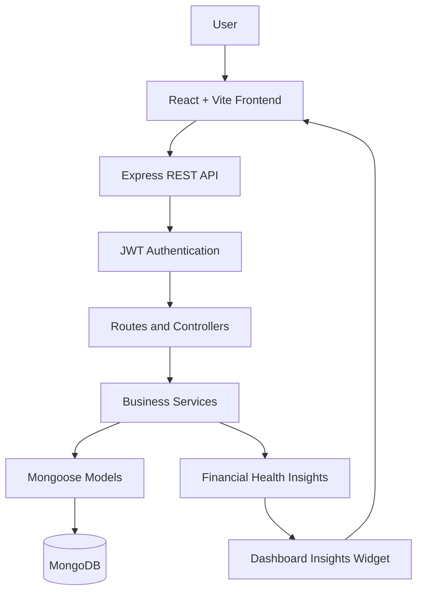

FinPilot — Agentic AI-Powered Personal Finance Management System with MCP Integration
FinPilot is a personal finance management platform built to help users organize their financial activity, monitor spending, manage budgets, and understand their financial patterns through a centralized dashboard. The project combines a React frontend with a Node.js/Express backend and MongoDB, with an AI-focused architecture intended to extend financial workflows through intelligent insights and tool-based interactions.
Highlights
- Secure authentication with user registration, login, password hashing, and JWT-protected routes.
- Expense tracking with transaction management, filtering, and paginated results.
- Income tracking to maintain a structured record of earnings.
- Budget management with spending progress and budget status information.
- Financial dashboard with summary metrics, recent activity, and visual analytics.
- Spending visualizations using category breakdowns and monthly trends.
- Recurring transactions for managing repeated financial entries.
- CSV export for taking financial records outside the application.
- Financial health insights that present a score and recommendations based on available financial data.
- Modular backend architecture that separates routes, controllers, services, models, and middleware.
Technology Stack
Area	Technologies
Frontend	React 18, Vite
Styling	Tailwind CSS
Charts	Recharts
Icons	Lucide React
Routing	React Router DOM
API communication	Axios
Backend	Node.js, Express.js
Database	MongoDB, Mongoose
Authentication	JWT, bcryptjs
Security and middleware	Helmet, CORS, Morgan
AI / agentic extension	LangChain.js, LangGraph.js, MCP integration (where enabled in the project version)

Application Architecture
FinPilot uses a modular, layered architecture. The frontend communicates with versioned REST endpoints, while the backend routes requests through authentication middleware and controllers to service-layer business logic and MongoDB models.

AI and MCP direction
The project is designed to extend its finance services with AI-assisted workflows. In an agentic implementation, LangChain.js can provide model and tool integration, LangGraph.js can coordinate multi-step execution, and MCP can standardize how compatible tools expose capabilities to an AI client. Any AI tool that reads or changes financial data should reuse existing service logic and derive the user identity from the authenticated server context.
The exact availability of LangChain.js, LangGraph.js, and MCP depends on the current repository version. The core application features below are represented by the source tree included with this project.

Core Features
Authentication and access control
- User registration and login.
- Password hashing with bcryptjs.
- JWT-based authentication for protected API routes.
- Centralized authentication middleware.
Expense and income management
- Create, retrieve, update, and delete transaction records.
- Organize transactions with categories.
- Retrieve records through API services with pagination and supported filters.
Budget management
- Create and maintain budgets for a given period.
- Track budget progress against recorded spending.
- Surface budget warnings and exceeded-budget states where configured.
Dashboard and analytics
- Summarize financial activity on a single dashboard.
- Visualize category-level spending.
- View monthly financial trends.
- Display recent transaction activity.
Recurring transactions
- Maintain recurring transaction definitions.
- Support recurring transaction processing through the backend service.
Financial insights and data export
- Generate a financial health score and recommendations from available financial data.
- Export financial records to CSV for external analysis or record keeping.
Repository Structure
finpilot-agentic-ai-mcp/
├── client/
│   ├── src/
│   │   ├── api/              # API clients and Axios configuration
│   │   ├── components/       # Shared UI and chart components
│   │   ├── context/          # Authentication and theme state
│   │   ├── pages/            # Dashboard and finance pages
│   │   └── App.jsx
│   └── package.json
├── server/
│   ├── src/
│   │   ├── config/           # Environment and database configuration
│   │   ├── controllers/      # HTTP request handlers
│   │   ├── middlewares/      # Authentication and error handling
│   │   ├── models/           # Mongoose schemas
│   │   ├── routes/           # Versioned API routes
│   │   ├── services/         # Finance and business logic
│   │   └── utils/            # Shared utilities
│   ├── server.js
│   └── package.json
├── docs/
│   ├── API_DOCUMENTATION.md
│   ├── ARCHITECTURE.md
│   ├── CODING_RULES.md
│   ├── DATABASE.md
│   ├── FEATURE_LOG.md
│   ├── PROJECT_CONTEXT.md
│   └── TODO.md
└── README.md
Getting Started
Prerequisites
- Node.js 18 or later
- npm
- MongoDB running locally or a MongoDB connection URI
1. Clone the repository
git clone https://github.com/YOUR_USERNAME/finpilot-agentic-ai-mcp.git
cd finpilot-agentic-ai-mcp
Replace YOUR_USERNAME with your GitHub username.
2. Configure the backend
cd server
npm install
Create server/.env using the variable names in server/.env.example. A typical local configuration includes:
PORT=5000
NODE_ENV=development
MONGODB_URI=mongodb://127.0.0.1:27017/financeflow
JWT_SECRET=replace_with_a_long_random_secret
Use the exact variable names expected by the application's environment configuration. Never commit secrets or your .env file.

Start the backend:
npm run dev
3. Configure the frontend
Open another terminal from the repository root:
cd client
npm install
npm run dev
Open the local URL printed by Vite, usually http://localhost:5173.
4. Verify the backend
The health endpoint is:
GET /api/v1/health
Ensure MongoDB is running and the backend starts successfully before testing the frontend.
API Overview
The backend exposes versioned REST endpoints under /api/v1. Confirm the route files for the full list of methods, request schemas, and response formats.
Endpoint	Purpose
/api/v1/health	Health check
/api/v1/auth/register	Register a user
/api/v1/auth/login	Log in
/api/v1/auth/me	Get the authenticated user's profile
/api/v1/categories	Retrieve categories
/api/v1/expenses	Expense operations
/api/v1/incomes	Income operations
/api/v1/budgets	Budget operations
/api/v1/dashboard	Dashboard summaries and analytics
/api/v1/insights	Financial health insights
/api/v1/recurring	Recurring transaction operations
/api/v1/export/csv	CSV export

Protected endpoints require a valid authentication token as configured by the backend.
Security
- Passwords are hashed rather than stored as plain text.
- Private routes are protected by JWT authentication middleware.
- Financial records should be queried within the authenticated user's scope.
- Environment secrets must remain outside version control.
- AI tools that access financial data should validate their arguments, enforce user-level authorization, and reuse the application's business services rather than bypassing them.
Engineering Principles
- Layered architecture: routes, controllers, services, and models have distinct responsibilities.
- Reusable business logic: finance calculations live in service modules.
- Centralized error handling: consistent handling of API errors.
- Maintainability: feature modules are separated for easier testing and extension.
- Security by design: authenticated access and user-scoped data operations.
Future Extensibility
The architecture can support additional AI-assisted financial workflows, expanded MCP tool interoperability, more advanced financial forecasting, and automated tests for agent-tool authorization. These extensions should be documented as implemented only when they are present and verified in the repository.
Author
Althaf Yazin
B.Tech Computer Science and Engineering
MAR ATHANASIUS COLLEGE OF ENGINEERING, Kerala
License
No license is specified by default. Add a license file if you intend to grant others permission to use, modify, and distribute this project.
